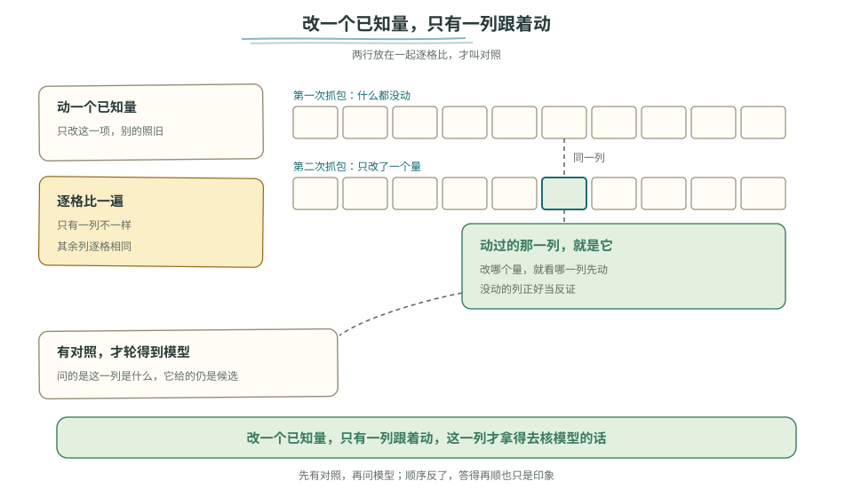
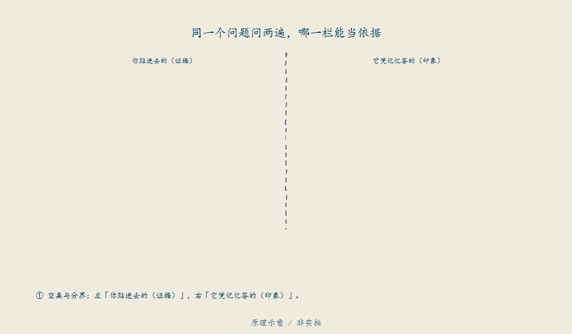

# 阶段 7 教程：BMS × AI（续集开篇）

> **任务**　用 1–2 周学会划分 AI 的工作边界、核对证据，并画出有人签字的判定链。
> **前置**　阶段 0–6 已过一遍；手上有能运行的保护板，或至少有一份完整实验记录。
> **边界**　模型可以解释、起草和给候选；阈值只认原文，判定交给程序，安全回路不接模型。

---

## 本页目录

- [7.1 开场那道题](stage-7-BMS与AI.md#71-开场那道题)
- [7.2 三圈边界：放手、签字、别碰](stage-7-BMS与AI.md#72-三圈边界放手签字别碰)
- [7.3 证据与印象：它没读过你的 datasheet](stage-7-BMS与AI.md#73-证据与印象它没读过你的-datasheet)
- [7.4 谁签字：解释归模型，判定归程序](stage-7-BMS与AI.md#74-谁签字解释归模型判定归程序)
- [7.5 五种失败模式与五个探针](stage-7-BMS与AI.md#75-五种失败模式与五个探针)
- [7.6 本集口诀](stage-7-BMS与AI.md#76-本集口诀)
- [7.7 验收清单 [评价]](stage-7-BMS与AI.md#77-验收清单-评价)

---

## 7.1 开场那道题

一块没有文档的 BMS 摆在桌上，上位机里只有一串十六进制。你要先让模型读，还是先抓包？

三个选项：**A** 先抓完整会话，拿已知量做对照，再让模型解释；**B** 先把报文丢给模型，让它列出可能的字段；**C** 让模型直接给一张寄存器映射表。

先选一个，再展开答案。

<details>
<summary><b>参考答案</b></summary>

选 **A**。先抓完整会话并改变一个已知量，才能得到可复核的证据。B 可以在抓包后用于列候选，C 会凭空补齐并不存在的测量。

</details>

BMS 结论最终要回答三件事：谁量的、量了几次、拿什么对照。模型没有接在总线上，它输出的是文字，不是读数。



> **看图**　凭什么把报文里的某一列认成某个量？

---

## 7.2 三圈边界：放手、签字、别碰

先把模型能碰的事分成三圈，从外往里越来越靠近电池：

外圈**能放手**：解释机制、起草文档与注释、当陪练、从已提供的原文里检索。出错通常只会浪费核对时间。

中圈**要签字**：故障归因只能给候选；保护阈值只认 datasheet 与仓库正文；代码和配置可以起草，合并必须复核。交付口径见[写代码的五个关卡](../AI陪练卡.md#写代码的五个关卡)。

内圈**别碰**：安全回路、寄存器与凭据写操作、OTA 签名、无人复核的自动动作和现场高压操作。



> **口诀**　能解释、能起草、能陪练。能给候选，不能给结论。越靠近电池，越要人手签字。

黄点依次穿过外圈和中圈，到内圈前停下。越靠近电池，边界越硬；这表示审批等级，不表示模型出错概率。

三圈的分法来自这个仓库的实战：阶段 5 的协议逆向是「外圈」，阶段 6 的功能安全与 OTA 验签是「内圈」。这不是某家芯片手册的规定，也不是标准条文。

---

## 7.3 证据与印象：它没读过你的 datasheet

模型擅长生成通顺的下文，但它没有你的板子，也没有你的 datasheet，除非你把原文放进上下文。

把输入分成两栏：左边是**已提供的材料**，例如 datasheet 片段、寄存器表、抓包日志和仓库正文；右边是**模型凭记忆补出的内容**，例如相似型号、常见做法和未经核对的解释。

阈值、位宽、单位和地址只认左边。签字前必须能回到原文或运行记录。

就地检查：从上一条模型回答里圈出所有数字，逐个标成“原文”“运行记录”或“无证据”。最后一类不得进入配置。



> **口诀**　数值只认原文，机制随便问。通顺不等于对，能回链才算证据。

动画中的红点试图从“模型记忆”跨进“证据”，但被挡回。材料只有同时满足“已放进上下文”和“能查到出处”，才算左栏证据。

---

## 7.4 谁签字：解释归模型，判定归程序

模型先读日志和已提供的原文，给候选原因排序，并标出依据行。随后交给确定性程序做校验、单位换算和越限比较；相同输入应得到相同结果。

判定这一格是签字格。人在这格签字，记录里留下是谁、依据哪一段原文。

如果把模型输出直接下发，就跳过了复算和签字，出错后也无法追溯判定依据。

最小签字记录可以很短，但下面几项不能缺：

```text
输入文件与版本：
判定程序与规则版本：
程序输出：
复核人、时间与结论：
```

模型原文可以作为附件，不能代替这张记录。程序、输入或规则版本发生变化后，旧签字不能沿用，必须完整重新执行一次并复核。



> **口诀**　模型可以给候选，程序才给判定。签字落在能复算的那一格。

蓝点沿“请求 → 模型候选 → 程序判定 → 人签字”前进；红点从模型直接拐向执行，在进入支路后被打回。

判断一个流程能不能上模型，只看一件事：出错时你能不能把那条结论重新算一遍。算不出来，这格就不该由模型占。

---

## 7.5 五种失败模式与五个探针

五种常见失败，各用一个探针核对：

| 失败模式 | 可疑回答 | 探针 |
|---|---|---|
| 编数字 | “建议设成 4.25 V，留一点余量” | 要出处：哪一页、哪一行，贴原文 |
| 串型号 | “这一颗也是 0x0B 地址吧” | 复述已提供原文中的对应行 |
| 过时手册 | “功能码用 0x03 就行” | 看读回值、抓包或报错原文 |
| 漏边界 | “按这个流程走就行” | 问断线、超时和故障注入时谁兜底 |
| 自信的错 | “一定是采样电阻温漂” | 换一种问法再问，比较两次依据 |



> **口诀**　要出处、要原文、要运行结果、要反例、换问法再问。

动画把五行错开显示，提醒核对者逐项排查。它们是使用方式的风险，不是某家模型的评测结论。

---

## 7.6 本集口诀

盖住上文，用 60 秒回答：

1. 哪些工作可以放手，哪些必须签字，哪些不能接模型？
2. 一个阈值怎样才算有证据？
3. 模型、程序和人，按什么顺序经过判定链？
4. 五个核对探针分别是什么？

答不全就回到对应的 7.2–7.5，不用重读整页。

---

## 7.7 验收清单 [评价]

- [ ] 能说出三圈边界，并各举一个例子：一件该放手让模型干的、一件必须人签字的
- [ ] 会把一个模糊问题改写成「只问机制、不给阈值」的提问（现场改，不许先想三天）
- [ ] 能用五个探针里的至少三个，指出一次真实模型回答里的可疑处
- [ ] 能画出你自己项目的判定链：哪一步是模型、哪一步是程序、谁签字、记录写在哪
- [ ] 写出你项目里「绝不交给模型」的三件事，每件写一句理由（不是「感觉不安全」）

> **配套练习**　[AI 陪练卡 · 阶段 7](../AI陪练卡.md#阶段-7) 提供三圈边界、判定链和五探针练习。让模型起草代码前，先过[写代码的五个关卡](../AI陪练卡.md#写代码的五个关卡)，再用[代码交付单](../AI陪练卡.md#代码交付单)收口。

---

> **本集对应的视频**　《阶段 7 · BMS × AI：大模型能做哪些活，哪些活不能碰》（BMS 从入门到精通 续集 第 1 集）。图与旁白同源：图里出现的每一句，都是这一页里的口径。
