# 阶段 7 教程：BMS × AI（续集开篇）

> **本篇你会学到**　大模型能替 BMS 工程做哪些活、这些活的结论凭什么算数，以及哪些活永远不能交给它。
> **预计用时**　1–2 周，边用边学。
> **前置**　正片七集（阶段 0–6）已经过一遍，手上有能跑的保护板或至少完整的实验记录。
> **一句话**　模型是很好的解释者和起草者，不是测量仪，也不是保护板。

> 对应学习路线的阶段 7，也是续集的第一集。正片把 BMS 从一块电池讲到毕业项目；续集讲怎么把大模型接进来替你干活——陪练、起草、翻译报文都行，但阈值、判定和安全回路不归它。
> 本阶段不教提示词魔法，只教边界与证据：什么时候它是加速器，什么时候它是有礼貌的猜测机器。

---

## 本页目录

- [7.1 开场那道题](stage-7-BMS与AI.md#71-开场那道题)
- [7.2 三圈边界：放手、签字、别碰](stage-7-BMS与AI.md#72-三圈边界放手签字别碰)
- [7.3 证据与印象：它没读过你的 datasheet](stage-7-BMS与AI.md#73-证据与印象它没读过你的-datasheet)
- [7.4 谁签字：解释归模型，判定归程序](stage-7-BMS与AI.md#74-谁签字解释归模型判定归程序)
- [7.5 五种失败模式与五个探针](stage-7-BMS与AI.md#75-五种失败模式与五个探针)
- [7.6 本集口诀](stage-7-BMS与AI.md#76-本集口诀)
- [7.7 验收清单 [评价]](stage-7-BMS与AI.md#77-验收清单-评价)

---

## 7.1 开场那道题

一块没有文档的 BMS 摆在桌上，上位机里只有一串十六进制。你要先让模型读，还是先抓包？

三个选项：**A** 先抓完整会话，拿已知量做对照，再让模型解释；**B** 先把报文丢给模型，让它列出可能的字段；**C** 让模型直接给一张寄存器映射表。

答案在片尾。先记住一句：模型能替你**解释**，不能替你**测量**——它没有接在那条总线上。

> **原理**　BMS 这边的每一句结论，最后都要落到「谁量的、量了几次、拿什么对照」。模型输出的是语言，不是读数；把语言当读数用，就是后面所有坑的同一个根。

---

## 7.2 三圈边界：放手、签字、别碰

先画边界，再谈用法。把大模型能碰的事分成三圈，从外往里越来越靠近电池：

外圈**能放手**：解释机制（把 DBC 字段讲成人话）、起草文档与注释、当陪练出题批改、从你贴的原文里检索。这一圈错了最坏是浪费时间——错误成本等于你的阅读时间。

中圈**要签字**：故障归因（只能给候选，不给结论）、保护阈值（只认 datasheet 与仓库正文）、改代码与配置（草稿可以，合并要人点）、以及任何「结论」这个词。错误成本是一次返工或一次事故复盘，所以必须留下「谁签的」。

内圈**别碰**：安全回路（AFE 与主控 MCU 说了算）、寄存器与凭据与 OTA 签名这类写操作、无人复核的自动动作、现场高压操作。这里不讨论「概率有多低」。

> **图说**　令牌沿左侧那道虚线闸门往下走，走到哪一圈哪一圈亮一次。它停在第三圈——不是因为它累了，是因为它没有资格再往里走。

> **口诀**　能解释、能起草、能陪练。能给候选，不能给结论。越靠近电池，越要人手签字。

**看动画时盯住哪里**

黄点是那枚令牌。它在第一圈和第二圈之间停一下，在第二圈和第三圈之间再停一下，第三次停下之后就不再动了。三个脉冲的亮度是递增的（外圈最淡、内圈最红）——边界越往里越硬，不是颜色好看。

三圈的分法来自这个仓库的实战：阶段 5 的协议逆向是「外圈」，阶段 6 的功能安全与 OTA 验签是「内圈」。这不是某家芯片手册的规定，也不是标准条文。

---

## 7.3 证据与印象：它没读过你的 datasheet

同一个问题问两遍，模型会给你两个都很像的答案。像，是因为它在用语言模型的本职工作：生成通顺的下文。它没有你的板子，也没有你的 datasheet——除非你把原文贴进上下文。

所以把输入分成两栏：左边是**你贴进去的**（datasheet 片段、寄存器映射表、抓包日志、仓库正文），右边是**它凭记忆答的**（参数量里的世界知识、上一个项目的习惯、看着像的相似型号、很顺的解释）。

凡是阈值、位宽、单位、地址，只认左边。左边错了是资料的错，能查、能回链；右边错了是你的错——因为你签了字。

> **图说**　那道竖虚线就是分界。红色箭头从右栏跨过来，被一个「越界就打回」挡住；打回的动作不是「让它再想想」，而是**你把问题改掉**——改问机制，别问保护点。

> **口诀**　数值只认原文，机制随便问。通顺不等于对，能回链才算证据。

**看动画时盯住哪里**

左栏从左边滑进来，右栏从右边滑进来——两栏是对向进场，因为它们是两种来源，不是同一件事的两个说法。右下那个红点沿着箭头跨过分界线，停在半路：跨界失败的那一下，就是「我贴了原文」和「它记得」之间的区别。

「左边」的判据只有一个：你确实把它贴进了上下文，并且自己能查到出处。做不到这两条，它就在右栏。

---

## 7.4 谁签字：解释归模型，判定归程序

请求进来，先过模型：读日志、读你贴的原文、给出**可能的原因并排序**，每条都附一句「看哪一行」。然后必须回到程序：校验、单位换算、越限比较——这些是确定性代码，同样的输入永远同样的输出，错了能复算。

判定这一格是签字格。人在这格签字，记录里留下是谁、依据哪一段原文。

支路是把模型的输出直接当结论下发：省掉判定，也省掉签字。读起来最顺，也最像真的；一旦错了，你查不到是谁定的，只能整批回滚。

> **图说**　蓝色那枚小点沿主链走：① 请求 → ② 模型（解释与候选）→ ③ 程序（判定）→ ④ 人签字。下面那枚红点走的是支路，从 ② 直接拐下来，被「打回：回到 ③」拦在中间。

> **口诀**　模型可以给候选，程序才给判定。签字落在能复算的那一格。

**看动画时盯住哪里**

蓝点是「一次正常的排查」。它在中途会停两次：第一次停在模型那一格（它在排序候选），第二次停在程序那一格（它在复算）。红点走到支路的中段就不再前进——那一步没有复算，也没有签字。

判断一个流程能不能上模型，只看一件事：出错时你能不能把那条结论重新算一遍。算不出来，这格就不该由模型占。

---

## 7.5 五种失败模式与五个探针

用法上的坑就那几种，每种都配一个探针——探针不是「让它更努力」，是**让它拿出证据**：

① **编数字**：给一个很具体的阈值（「建议设成 4.25 V，留一点余量」）。越具体越像真的，小数位是它最容易编出来的东西。探针：要出处——哪一页、哪一行，贴原文。

② **串型号**：把相近型号的默认值搬过来（「这一颗也是 0x0B 地址吧」）。差一个后缀，寄存器表就换了。探针：让它复述你贴的原文那一行。

③ **过时手册**：记的是上一版（「功能码用 0x03 就行」）。旧习惯不一定错，但可能不是你这台设备这一版。探针：贴运行结果——读回值、抓包、报错原文。

④ **漏边界**：只讲常态（「按这个流程走就行」），很少主动说断线怎么办、超时怎么办。探针：问反例——故障注入怎么走、谁兜底。

⑤ **自信的错**：语气最肯定那一条往往最该验（「一定是因为采样电阻温漂」）。探针：同一问题换个问法再问一遍，两次矛盾就暴露了它是猜的。

> **图说**　五行依次进场，每行右边那根置信度条都是满的——它的语气和它对不对，是两件事。行越往下出现得越晚，是因为这五种坑有先后：先信了数字，才会去串型号。

> **口诀**　要出处、要原文、要运行结果、要反例、换问法再问。

**看动画时盯住哪里**

每一行进场时都从下方 12 px 处滑上来并淡入，五行错开出现——这不是好看，是提醒你它们**不是同时被发现的**：一次排查里，你通常只抓住其中一个，剩下的要专门去找。

这五种是使用方式的失败，不是某家模型的评测结论。换模型不解决问题，「要证据」才解决。

---

## 7.6 本集口诀

> **口诀**　能解释、能起草、能陪练。能给候选，不能给结论。

> **口诀**　数值只认原文，机制随便问。通顺不等于对，能回链才算证据。

> **口诀**　模型可以给候选，程序才给判定。签字落在能复算的那一格。

> **口诀**　要出处、要原文、要运行结果、要反例、换问法再问。

---

## 7.7 验收清单 [评价]

- [ ] 能说出三圈边界，并各举一个例子：一件该放手让模型干的、一件必须人签字的
- [ ] 会把一个模糊问题改写成「只问机制、不给阈值」的提问（现场改，不许先想三天）
- [ ] 能用五个探针里的至少三个，指出一次真实模型回答里的可疑处
- [ ] 能画出你自己项目的判定链：哪一步是模型、哪一步是程序、谁签字、记录写在哪
- [ ] 写出你项目里「绝不交给模型」的三件事，每件写一句理由（不是「感觉不安全」）

> **原理**　验收问的是能不能用边界做判断。勾得上才进入续集下一集（报文翻译与日志排查）；勾不上就回到 7.4，把签字格划清楚再来。

---

> **本集对应的视频**　《阶段 7 · BMS × AI：大模型能做哪些活，哪些活不能碰》（BMS 从入门到精通 续集 第 1 集）。图与旁白同源：图里出现的每一句，都是这一页里的口径。
